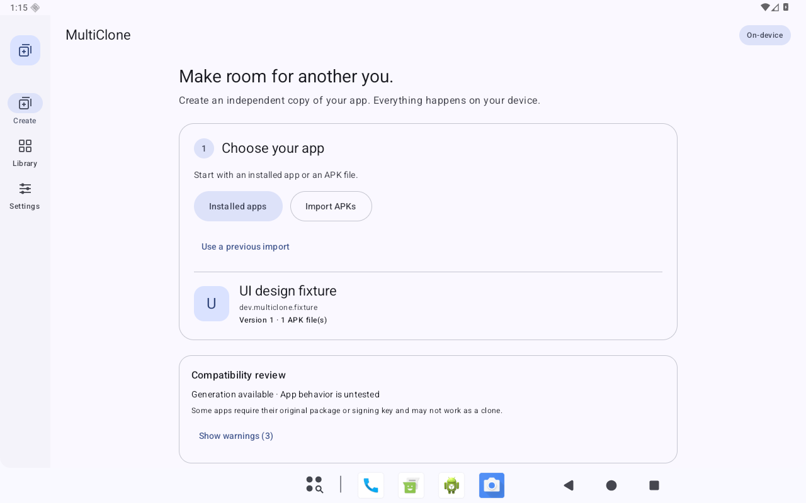

# MultiClone

[Download the latest release](https://github.com/AriyenG1/MultiClone/releases/latest) · [Installation guide](docs/TABLET_GUIDE.md) · [Changelog](CHANGELOG.md)

A local Android APK cloning project for stock Android, written in Kotlin and Jetpack Compose.
Version 0.1.3 adds an adaptive Material 3 tablet interface, collapsed compatibility details and an in-context install window. It includes the reusable clone workflow, persistent batches, individual updates and encrypted signing backups. Its library shows current clones and active jobs, with complete clone deletion and removal after a confirmed Android uninstall. See [STATUS.md](docs/STATUS.md) for verified capabilities, [TABLET_GUIDE.md](docs/TABLET_GUIDE.md) for installation, and [PLAY_PROTECT.md](docs/PLAY_PROTECT.md) for the reported Google warning and review process.

MultiClone creates new Android packages and signing identities. Clones start with fresh app data. Existing credentials are never copied. Repackaging can break login, signature permissions, verified links, native code and integrity checks; successful generation does not establish runtime compatibility. No protections are bypassed.

## Preview



## Build

For a standard checkout, install JDK 17 and the Android SDK packages listed below, set `ANDROID_HOME` (or create your own `local.properties`), then run `./gradlew :app:assembleDebug`. Android Studio can also open the root project. Signing keys and machine-specific SDK paths are excluded from this repository.


The local development setup uses `.tools/jdk/Contents/Home` (Temurin 17), `.tools/android-sdk`, Gradle 9.6.0 and AGP 9.4.0. It does not change global Java settings.

```sh
scripts/gradle-local.sh :app:assembleDebug :test-app:assembleDebug
scripts/gradle-local.sh :signing:testDebugUnitTest :apk-engine:testDebugUnitTest
scripts/gradle-local.sh :app:connectedDebugAndroidTest
```

Override `MULTICLONE_JAVA_HOME` and `MULTICLONE_SDK` to use another installation. SDK packages: platform 37.0, Build Tools 36.0.0 and platform tools. Only emulator-based development tests need an emulator; installed MultiClone performs processing on-device.

## Modules

- `core`: models and processing interfaces.
- `apk-engine`: bounded APK inspection, binary resource/manifest changes, conservative DEX transformations and ZIP alignment.
- `signing`: embedded APK signing, key vault and authenticated password-encrypted backups.
- `platform`: installed-app discovery, document import and Android installation sessions.
- `storage`: Room-backed source, clone and queue records.
- `app`: Android application and Compose controls.
- `test-app`: Apache-2.0 isolation fixture with persistent counter, local mock account and private content provider.

MultiClone has no INTERNET permission. Generated applications retain their own permissions and networking. External browser cookies or account brokers can still be shared during third-party authentication.

## Compatibility policy

Installed user applications and standalone APKs are the starting point. Supplied split sets must have one base, consistent identities, matching verified certificates and complete declared dependencies. Single-set `.apks` archives can be imported; bundletool archives containing multiple alternative variants must first be reduced to one compatible set. AAB, APKM, XAPK, asset delivery, shared-UID apps, overlays and privileged package types are outside initial support.

Only recognized terminal self-provider `Uri.parse` calls are rewritten in DEX. Arbitrary package strings, reflection, native code, OAuth registrations and protection checks are not rewritten. Static analysis reports risks rather than certifying compatibility. A tablet report for Riot Mobile version 508001003 (four APKs) shows Android verifier rejection during installation; runtime compatibility remains untested.

Dependency notices and upstream links are in [THIRD_PARTY_NOTICES.md](THIRD_PARTY_NOTICES.md).

## Fixtures and release packaging

Prepare instrumented-test assets with `scripts/prepare-test-fixtures.sh`. It builds versions 1 and 2 of the fixture, a separate feature/configuration split set, and the pinned Jetchat sample. Test assets are bundled only into the instrumentation APK.

Package a signed release with `scripts/package-release.sh`. It creates a separate local release key under ignored `private/` on first use. Preserve that directory securely to sign future application updates.

## UI design guidance

The installed Android design and UI/UX skills and Google adaptive-layout references are configured in `AGENTS.md`. See [the tablet UI audit](docs/ui/TABLET_UI_AUDIT.md) for the redesign and verified source paths.
