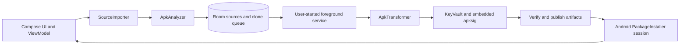

# MultiClone architecture

The application coordinates modules through Kotlin models and explicit constructor wiring. `core` defines source parts, findings, clone plans, artifacts and signing interfaces. `apk-engine` edits binaries without desktop executables. `platform` owns Android package discovery, document import and installation. `storage` owns Room records and DataStore preferences. `signing` owns certificates, local wrapping and password-encrypted backups.

## Identity transformation

Every clone gets a stable UUID-based package and a distinct signing certificate. The implementation retains original DEX class names, expands manifest-relative component names, and changes the installed package identity. It maps self-provider authorities, custom permission definitions/references, recognized process names and task affinities. Resource IDs remain unchanged; self-package resource names and resource-library references are updated. Custom names use a dedicated string resource and launcher labels. Custom icons use dedicated raster and adaptive-icon resources.

DEX rewriting is deliberately narrow: a straight-line terminal `const-string → Uri.parse → move-result → return` sequence referring to a provider declared by that same source. Branches and exception handlers prevent that rule from applying. Class descriptors, reflection strings, arbitrary URLs and protection checks are preserved. Other hardcoded identities remain a reported runtime risk.

Split names and dependency metadata are preserved. All parts get the same generated package, version and certificate. Configurations/features are installed with their base through one session, without merging. No code for Play feature/asset delivery or authentication bypass is injected.

## Jobs and crash recovery

Batch requests store a total and completed count rather than preallocating every clone record. One mutex-protected runner processes clones sequentially. A user-started `dataSync` service provides notification progress; Android's quotas and timeouts still apply.

Unsigned outputs stay in staging directories. Signed outputs are verified, moved atomically into a completed artifact directory, then referenced by the database. On process restart, running jobs pause, incomplete clone records become failed, and stale staging directories are removed. An update retains the old usable record until its new artifacts are verified.

Installation success is distinct from artifact generation. Android owns confirmation and installation/removal. Dashboard package state is reconciled on resume and package-change broadcasts. User-marked runtime test results apply only to the matching installed version.

`CloneLibrary` reconciles installed packages and owns removal. A persisted `wasInstalled` flag distinguishes never-installed artifacts/restored identities from removed apps. Missing previously installed packages are removed with their local artifacts/key, except while a matching installer session is pending. Package-removal broadcasts marked as replacement are ignored. Explicit Delete clone checks Android installation state and requests its uninstall flow before removing an installed clone. Cancellation retains the entry. Removal, result persistence, installation submission and each individual build publication share the queue's clone-mutation lock. Active queued/paused updates for a deleted identity are cancelled; terminal job history is omitted from the dashboard.

## Keys and privacy

Each clone's RSA key is encrypted with AES-GCM under an Android Keystore wrapping key. Export rewraps keys and clone metadata in a versioned AES-GCM envelope using PBKDF2-HMAC-SHA256, 600,000 iterations, a random 16-byte salt and a random 12-byte nonce. The envelope header is authenticated. Existing keys cannot be replaced by a conflicting backup certificate.

MultiClone declares no INTERNET permission and includes no telemetry. Cloud backup and device transfer are excluded; recovery uses the explicit encrypted export. Credentials and other apps' private data are never imported.

## Build reproducibility

Gradle 9.6.0 is pinned with a distribution SHA-256. Direct dependencies are versioned, transitive resolution is locked, and Gradle verifies downloaded artifact checksums. Release signing uses `private/release-signing.p12`, separate from tablet-generated clone keys. Preserve the entire `private/` directory securely for future MultiClone application updates; it is excluded from version control and source archives.
